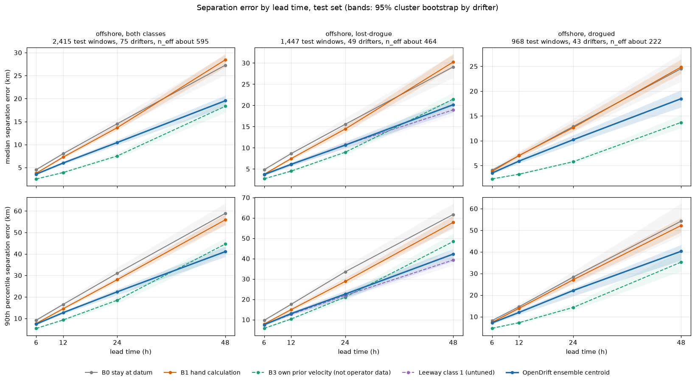
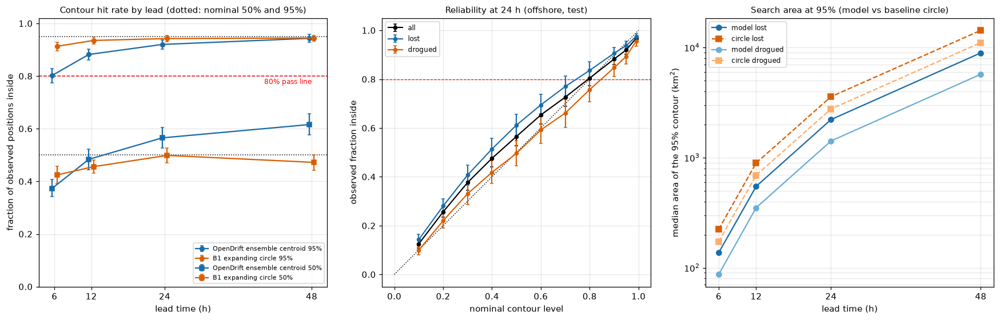
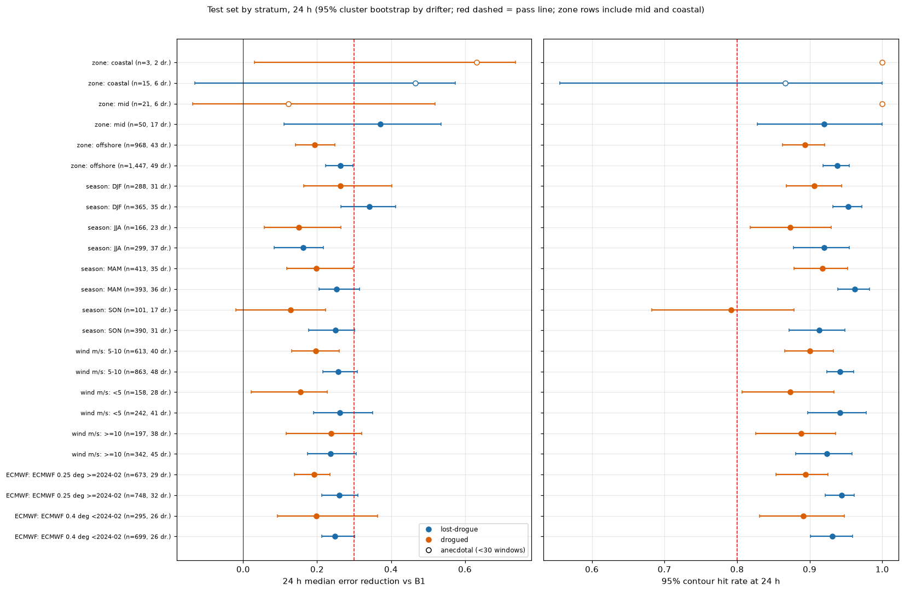
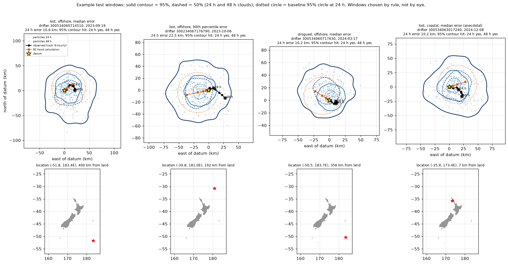
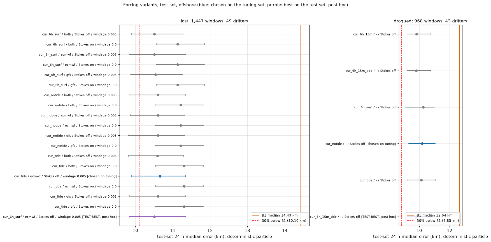

# OpenDrift drift hindcast for New Zealand SAR on free forcing data: final report

Spike folder: `drift-hindcast-spike`. Tables in this report are generated from the CSV files in `results/` by `scripts/s11_build_report.py` (kilometre values as in the CSV files, up to 5 significant digits; fractions shown as percent). Figures are in `figures/`. OpenDrift 1.14.12. This spike builds nothing for production. It produces evidence for a go / no-go decision.

## 1. Result in brief

**Recommendation: NO-GO for the free-data-only plan as specified. A bounded follow-up is justified before the idea is dropped (section 9).**

| Criterion (agreed with the user) | Result on the test set | Verdict |
|---|---|---|
| 1. Offshore: median 24 h separation error at least about 30% below the hand-calculation baseline | Pooled: model 10.451 km vs baseline 13.685 km, **23.6% lower** (95% CI 20.2% to 26.8%) | **FAIL** |
| 1, lost-drogue drifters only | 10.632 km vs 14.429 km, 26.3% lower (CI 21.9% to 29.7%) | BORDERLINE |
| 1, drogued drifters only | 10.2 km vs 12.636 km, 19.3% lower (CI 13.9% to 24.9%) | FAIL |
| 2. After tuning, the 95% contour holds at least about 80% of observed endpoints (24 h, offshore) | **92.0%** (CI 90.3% to 93.6%). The 50% contour holds 56.5% (CI 52.7% to 60.5%) | **PASS**, but only with a tuned layer outside OpenDrift (section 5.3) |
| 3. Coastal skill (not pass/fail) | 18 test windows from 8 drifters | reported, **anecdotal** |

- The model does not clearly beat the baseline offshore. The whole confidence interval for the pooled 24 h reduction lies below 30%.
- The model is better than the baseline at every lead (pooled reduction 5.4% at 6 h, 17.6% at 12 h, 23.6% at 24 h, 31.3% at 48 h), so the result is "useful but short of the target", not "no skill".
- Calibration was reached by adding a tuned persistent-velocity offset outside OpenDrift. OpenDrift's own uncertainty keys alone produce contours that hold about 0% of the endpoints.
- The hindcast used best-estimate analysis currents. CMEMS keeps no archived forecasts, so **live results will be somewhat worse than the numbers here**. The size of the loss was not measured.
- The tests used 35 cm GDP drifters, not people or boats, with the start position and time known exactly. Section 8 lists what this test cannot show.
- The intended use is live SAR support for RCCNZ-style users, so uncertainty must be shown to operators together with measured hit rates, not just a contour on a map (section 9).

## 2. Data and method

### 2.1 Data

| Item | Source | What was used |
|---|---|---|
| Drifter tracks | NOAA AOML Global Drifter Program, ERDDAP `drifter_6hour_qc` (6-hourly, ends 2025-06-18) | 6-hourly positions, `drogue_lost_date`, `err_lat`/`err_lon`, in lon 158 to 187 E, lat -57 to -23, from 2022-12-01. The 1-hourly dataset ends 2022-10-31, before CMEMS GLO12 starts, so it was not usable. |
| Currents | Copernicus Marine GLOBAL_ANALYSISFORECAST_PHY_001_024 | `cmems_mod_glo_phy_anfc_merged-uv_PT1H-i` (hourly, 0.494 m, with tidal components `utide`/`vtide`, and Stokes drift `vsdx`/`vsdy`); `cmems_mod_glo_phy-cur_anfc_0.083deg_PT6H-i` (6-hourly, no tides, 0.494 m and 15.81 m). Analysis fields only. |
| Winds | NOAA GFS 0.25 deg (AWS `noaa-gfs-bdp-pds`, archive starts 2021-01-01) and ECMWF IFS open data (AWS `ecmwf-forecasts`, CC-BY-4.0, archive starts 2023-01-18; 2023-01-17 returns 404) | 10 m wind in forecast mode: cycle at t0 minus 12 h, forecast hours 12 to 60 in 3 h steps (00Z and 12Z operational cycles only). ECMWF is 0.4 deg until 2024-01-31 and 0.25 deg from 2024-02-11. The ECMWF 12Z cycles of 2023-05-01 and 2023-05-02 are missing from the archive. |

- **No archived forecast currents.** CMEMS does not keep archived forecasts. The hindcast uses the best-estimate analysis, which has seen later observations than a live forecast would have. Live skill will be lower. The winds are the part that was done in forecast mode.
- **Stokes drift** comes from the merged-uv `vsdx`/`vsdy` fields (same wave model, MFWAM). The separate wave product was not downloaded or compared.
- The CMEMS system versions in the period 2023 to 2025 and whether drifter data are assimilated into GLO12 were not checked (see limitations).
- Data volumes: GDP 20 MB, CMEMS 6.2 GB (216 files), winds 350 MB. Everything is under `data/` (git-ignored). Details: `work/data_notes.md`.
- Forcing sanity check against the drifters' own velocity (test set, chosen currents): vector RMSE 0.22 m/s (lost) and 0.19 m/s (drogued), vector correlation 0.62 and 0.60 (`results/forcing_check.csv`).

### 2.2 Windows and the split

- **Time sampling.** 72 blocks of 96 h (60 random, 2 per calendar month from 2023-01 to 2025-06, plus 12 targeted at coastal drifters). Each block has two 00Z seed times, 48 h apart, so windows from one drifter in a block do not overlap. There is no forcing between the blocks.
- **Window.** A 48 h track of 9 consecutive 6-hourly observations that passes the filters (position error under 0.05 deg, speed under 2.5 m/s, not after the last good time). The simulation is seeded at the observed position at t0 and compared with the observed positions at 6, 12, 24 and 48 h.
- **Strata.** Offshore: the minimum distance to land over the window is more than 50 km. Coastal: under 10 km. Mid: in between. Drogued versus drogue-lost from `drogue_lost_date`. Windows straddling the loss date were excluded (387 candidate windows from 31 drifters).
- **Tuning and test sets.** Drifters were split once, at random, 40% tuning and 60% test. A drifter is in one set only (asserted in code). Everything tuned used the tuning set only (section 6). Every number in sections 4 and 5 is a test-set number unless it says otherwise.
- **Non-independence.** Windows from one drifter, and windows on the same date, are correlated. Confidence intervals come from a cluster bootstrap that resamples whole drifters (2,000 replicates, seed 42). The headline numbers are also bootstrapped with 96 h blocks as clusters, and the wider of the two intervals is quoted. The tables show an approximate effective sample size `n_eff`, estimated from the intra-drifter correlation of the 24 h error.

### 2.3 Decisions on the open points

| Open point | Decision | Why |
|---|---|---|
| Model for lost-drogue drifters | OpenDrift `OceanDrift` with the chosen hourly current (`cur_tide`: `uo + utide`), ECMWF 10 m wind as a windage fraction of 0.5% (`wind_drift_factor` 0.005), Stokes drift off. | A GDP drifter is a 35 cm float, so there is no calibrated Leeway class for it. Windage was tuned on the tuning set from a grid of 0 to 3%. Stokes drift on was worse on the tuning set (best Stokes-on variant 11.50 km, chosen variant 11.19 km, 24 h median). |
| Model for drogued drifters | `OceanDrift`, no windage, no Stokes, chosen current `cur_notide` (hourly `uo`, `vo`, 0.494 m). | The drogue holds the float in the water at about 15 m. The 15 m current variants were tested too (section 5.5). |
| Leeway | Run as a reference for the lost class only: object class 1 (person-in-water, unknown state), same current and wind, untuned. Not part of any criterion. | Leeway is what a SAR tool would use for a person. The drifter result says nothing about a person (section 8). |
| Hand-calculation baseline (B1) | Datum, plus one drift vector `V = U_cur + k x U_wind` taken once at the datum at t0 and held for 48 h, plus an expanding circle `R(t) = a x t`. `U_cur` is the same CMEMS current (0.494 m for lost, 15.81 m for drogued). `k` = 0.005 for lost, 0 for drogued, with ECMWF wind. The circle slopes were set on the tuning set to the 50% and 95% quantiles of the 24 h B1 error (lost: 0.582 and 1.406 km/h; drogued: 0.538 and 1.236 km/h). | The baseline gets the same tuning help as the model. It uses the model's own current field, so the test measures what particle tracking adds over a one-point snapshot. It does not test against a baseline that uses no ocean model. |
| Reference lines (not criteria) | B0: stay at the datum. B3: the drifter's own mean velocity over the 12 h before t0 carried forward. | B3 needs the drifter's own earlier track, which an operator does not have at t0. It shows how much plain persistence achieves. |
| Windows and independence | See 2.2. | |
| Combining GFS and ECMWF ("both") | Arithmetic mean of u and v, after ECMWF is bilinearly interpolated to the GFS grid. | Simplest option. It was tested as a variant. It was not the chosen variant. |
| CMEMS dataset ids | The two ids above, confirmed in the catalogue (`work/describe_*.json`). | |
| Model error definition | Distance from the observed position to the centroid of the 500-particle ensemble. The deterministic-particle and no-offset variants are shown as sensitivity rows. | Headline definition fixed before those variants were computed. |
| Ensemble and contours | 500 particles per window (300 in tuning), 900 s step, Runge-Kutta, 6-hourly output. Contours are highest-density regions of a Gaussian kernel density estimate with a 3 km minimum bandwidth. | The self-test in `drift_lib.py` checks hit fractions on Gaussian samples. |

Verdict thresholds were fixed in `scripts/config.py` before the test-set numbers were looked at. Criterion 1: PASS at 30% or more, BORDERLINE from 25% to under 30% (reading "about 30%"), FAIL below 25%. Criterion 2: PASS at 80% or more, BORDERLINE from 75%, FAIL below.

## 3. Sample sizes at each step

Funnel from the raw GDP query to the evaluation sets (`results/step0_counts.csv`; generated by `scripts/s02_windows_stepzero.py` before any forcing was downloaded). For steps 1 to 5 the "Windows" column holds six-hourly observation rows, not windows. A track is a run of at least 9 consecutive six-hourly observations.

| Step | Stratum | Drifters | Tracks | Windows | Drifter-days |
|---|---|---|---|---|---|
| 1 wide box + time (raw) | all | 172 | 339 | 140,362 | 35,090 |
| 2 position error < 0.05 deg | all | 172 | 376 | 139,541 | 34,885 |
| 3 time <= end_date (last good) | all | 172 | 376 | 139,511 | 34,878 |
| 4 observation box 160-185E 55-25S | all | 141 | 331 | 109,168 | 27,292 |
| 5 seed period 2023-01-21..2025-06-16 | all | 138 | 318 | 104,192 | 26,048 |
| 6 candidate 48 h windows (6 h stride) | all | 134 |  | 101,472 |  |
| 7 after max 2.5 m/s speed check | all | 134 |  | 101,462 |  |
| 8 drogue state | drogued | 80 |  | 38,432 |  |
| 8 drogue state | excl_straddle | 31 |  | 387 |  |
| 8 drogue state | lost | 86 |  | 62,643 |  |
| 9 class x zone (6 h stride) | drogued / coastal | 4 |  | 49 |  |
| 9 class x zone (6 h stride) | drogued / mid | 14 |  | 912 |  |
| 9 class x zone (6 h stride) | drogued / offshore | 80 |  | 37,471 |  |
| 9 class x zone (6 h stride) | lost / coastal | 15 |  | 294 |  |
| 9 class x zone (6 h stride) | lost / mid | 31 |  | 1,834 |  |
| 9 class x zone (6 h stride) | lost / offshore | 86 |  | 60,515 |  |
| 10 non-overlapping (48 h stride) | drogued / coastal | 4 |  | 6 |  |
| 10 non-overlapping (48 h stride) | drogued / mid | 14 |  | 112 |  |
| 10 non-overlapping (48 h stride) | drogued / offshore | 80 |  | 4,750 |  |
| 10 non-overlapping (48 h stride) | lost / coastal | 15 |  | 40 |  |
| 10 non-overlapping (48 h stride) | lost / mid | 31 |  | 232 |  |
| 10 non-overlapping (48 h stride) | lost / offshore | 86 |  | 7,643 |  |
| 11 seed at 00Z only | drogued / coastal | 4 |  | 13 |  |
| 11 seed at 00Z only | drogued / mid | 14 |  | 228 |  |
| 11 seed at 00Z only | drogued / offshore | 80 |  | 9,387 |  |
| 11 seed at 00Z only | lost / coastal | 15 |  | 78 |  |
| 11 seed at 00Z only | lost / mid | 31 |  | 456 |  |
| 11 seed at 00Z only | lost / offshore | 86 |  | 15,153 |  |
| 12 blocks chosen | 72 blocks = 60 random + 12 coastal-targeted |  |  |  |  |
| 13 selected windows (blocks) | drogued / coastal | 3 |  | 4 |  |
| 13 selected windows (blocks) | drogued / mid | 10 |  | 33 |  |
| 13 selected windows (blocks) | drogued / offshore | 72 |  | 1,496 |  |
| 13 selected windows (blocks) | lost / coastal | 10 |  | 31 |  |
| 13 selected windows (blocks) | lost / mid | 27 |  | 78 |  |
| 13 selected windows (blocks) | lost / offshore | 82 |  | 2,444 |  |
| 14 tuning set | drogued / coastal | 1 |  | 1 |  |
| 14 tuning set | drogued / mid | 4 |  | 12 |  |
| 14 tuning set | drogued / offshore | 29 |  | 528 |  |
| 14 tuning set | lost / coastal | 4 |  | 16 |  |
| 14 tuning set | lost / mid | 10 |  | 28 |  |
| 14 tuning set | lost / offshore | 33 |  | 985 |  |
| 14 test set | drogued / coastal | 2 |  | 3 |  |
| 14 test set | drogued / mid | 6 |  | 21 |  |
| 14 test set | drogued / offshore | 43 |  | 968 |  |
| 14 test set | lost / coastal | 6 |  | 15 |  |
| 14 test set | lost / mid | 17 |  | 50 |  |
| 14 test set | lost / offshore | 49 |  | 1,459 |  |
| 15 offshore by season | test / DJF | 58 |  | 653 |  |
| 15 offshore by season | test / JJA | 55 |  | 465 |  |
| 15 offshore by season | test / MAM | 62 |  | 818 |  |
| 15 offshore by season | test / SON | 44 |  | 491 |  |
| 15 offshore by season | tuning / DJF | 40 |  | 453 |  |
| 15 offshore by season | tuning / JJA | 34 |  | 255 |  |
| 15 offshore by season | tuning / MAM | 46 |  | 542 |  |
| 15 offshore by season | tuning / SON | 20 |  | 263 |  |

Selected windows: 4,086 in total (offshore 3,940, mid 111, coastal 35), of which 1,570 are in the tuning set and 2,516 in the test set. The sample is large enough to interpret for offshore drifters. For coastal drifters it is anecdotal. Windows without ECMWF winds (seed time 2023-05-03) have no model result, so the offshore test windows that were evaluated number 2,415 (1,447 lost, 968 drogued) against 2,427 selected. Sample sizes behind every table, with the approximate effective sample size:

| Set | Zone | Class | Windows | Drifters | 96 h blocks | Windows per drifter | ICC (24 h error) | n_eff (approx.) | Anecdotal |
|---|---|---|---|---|---|---|---|---|---|
| test | offshore | all | 2,415 | 75 | 72 | 32.2 | 0.09812 | 594.63 | no |
| test | offshore | lost | 1,447 | 49 | 72 | 29.531 | 0.07422 | 464.15 | no |
| test | offshore | drogued | 968 | 43 | 66 | 22.512 | 0.15634 | 221.86 | no |
| test | mid | all | 71 | 23 | 36 | 3.087 | 0.12165 | 56.624 | no |
| test | mid | lost | 50 | 17 | 26 | 2.9412 | 0.080985 | 43.208 | no |
| test | mid | drogued | 21 | 6 | 12 | 3.5 | 0 | 21 | yes |
| test | coastal | all | 18 | 8 | 10 | 2.25 | 0.41774 | 11.825 | yes |
| test | coastal | lost | 15 | 6 | 8 | 2.5 | 0.43948 | 9.0404 | yes |
| test | coastal | drogued | 3 | 2 | 3 | 1.5 | 0 | 3 | yes |
| tuning_in_sample | offshore | all | 1,503 | 50 | 72 | 30.06 | 0.11151 | 354.45 | no |
| tuning_in_sample | offshore | lost | 975 | 33 | 72 | 29.545 | 0.083072 | 289.2 | no |
| tuning_in_sample | offshore | drogued | 528 | 29 | 63 | 18.207 | 0.25423 | 98.242 | no |

The pooled offshore test sample is 2,415 windows, but only about 595 effectively independent ones from 75 drifters. The drogued sample is smaller still (n_eff about 222). "Anecdotal" marks groups with fewer than 30 windows or fewer than 8 drifters.

## 4. Results by lead time

### 4.1 Separation error (test set, offshore)

Median error with the 95% cluster-bootstrap interval for the model, and the median for the baselines. "Reduction" is 1 - median(model error) / median(baseline error) on the same windows. B3 uses information an operator does not have.

| Class | Lead h | Windows | Drifters | Model median km (95% CI) | Model p90 km | B0 median km | B1 median km | B1 p90 km | B3 median km | Reduction vs B1 (95% CI) | Reduction vs B0 (95% CI) |
|---|---|---|---|---|---|---|---|---|---|---|---|
| all | 6 | 2,415 | 75 | 3.5673 (3.422 to 3.7839) | 7.3509 | 4.5428 | 3.7709 | 7.663 | 2.5219 | 5.4% (1.6% to 8.5%) | 21.5% (16.8% to 25.0%) |
| all | 12 | 2,415 | 75 | 5.9985 (5.6719 to 6.3071) | 12.694 | 8.0263 | 7.2798 | 14.518 | 3.9224 | 17.6% (14.6% to 21.1%) | 25.3% (20.6% to 29.1%) |
| all | 24 | 2,415 | 75 | 10.451 (9.8921 to 11.049) | 22.373 | 14.548 | 13.685 | 28.035 | 7.522 | 23.6% (20.5% to 26.6%) | 28.2% (24.8% to 31.6%) |
| all | 48 | 2,415 | 75 | 19.538 (18.198 to 20.692) | 41.059 | 27.268 | 28.444 | 55.869 | 18.336 | 31.3% (27.7% to 35.4%) | 28.3% (24.6% to 32.8%) |
| lost | 6 | 1,447 | 49 | 3.6983 (3.4574 to 3.969) | 7.5011 | 4.834 | 3.7548 | 7.8782 | 2.6981 | 1.5% (-1.6% to 5.9%) | 23.5% (18.5% to 29.7%) |
| lost | 12 | 1,447 | 49 | 6.1075 (5.7121 to 6.5003) | 13.002 | 8.6433 | 7.4597 | 14.943 | 4.5043 | 18.1% (14.5% to 22.0%) | 29.3% (25.4% to 33.7%) |
| lost | 24 | 1,447 | 49 | 10.632 (9.9298 to 11.423) | 22.556 | 15.545 | 14.429 | 28.798 | 8.9547 | 26.3% (22.3% to 29.7%) | 31.6% (28.6% to 35.9%) |
| lost | 48 | 1,447 | 49 | 20.162 (18.365 to 21.473) | 42.236 | 29.079 | 30.232 | 57.825 | 21.481 | 33.3% (29.3% to 38.0%) | 30.7% (26.9% to 35.5%) |
| drogued | 6 | 968 | 43 | 3.4871 (3.2558 to 3.7211) | 7.1066 | 4.0853 | 3.8259 | 7.4053 | 2.3088 | 8.9% (3.6% to 13.3%) | 14.6% (9.3% to 20.2%) |
| drogued | 12 | 968 | 43 | 5.9064 (5.4465 to 6.4585) | 11.989 | 6.9898 | 7.0377 | 13.894 | 3.2506 | 16.1% (11.6% to 21.1%) | 15.5% (10.0% to 22.9%) |
| drogued | 24 | 968 | 43 | 10.2 (9.3343 to 11.121) | 22.101 | 12.862 | 12.636 | 27.078 | 5.7593 | 19.3% (14.1% to 24.9%) | 20.7% (14.8% to 27.0%) |
| drogued | 48 | 968 | 43 | 18.48 (16.765 to 20.216) | 40.266 | 24.532 | 24.867 | 52.206 | 13.702 | 25.7% (20.5% to 31.2%) | 24.7% (17.6% to 30.6%) |

90th percentile error:

| Class | Lead h | Model p90 km (95% CI) | B0 p90 km | B1 p90 km | B3 p90 km |
|---|---|---|---|---|---|
| all | 6 | 7.3509 (7.0008 to 7.666) | 9.1666 | 7.663 | 5.3519 |
| all | 12 | 12.694 (11.931 to 13.272) | 16.537 | 14.518 | 9.2934 |
| all | 24 | 22.373 (20.897 to 23.659) | 31.022 | 28.035 | 18.472 |
| all | 48 | 41.059 (38.615 to 43.501) | 58.835 | 55.869 | 44.599 |
| lost | 6 | 7.5011 (7.0109 to 8.0067) | 9.6616 | 7.8782 | 5.7369 |
| lost | 12 | 13.002 (12.105 to 13.858) | 17.548 | 14.943 | 10.328 |
| lost | 24 | 22.556 (20.789 to 24.253) | 33.535 | 28.798 | 21.079 |
| lost | 48 | 42.236 (38.693 to 44.799) | 61.724 | 57.825 | 48.422 |
| drogued | 6 | 7.1066 (6.5787 to 7.555) | 8.2053 | 7.4053 | 4.6362 |
| drogued | 12 | 11.989 (10.934 to 13.057) | 14.622 | 13.894 | 7.2261 |
| drogued | 24 | 22.101 (19.495 to 23.22) | 28.321 | 27.078 | 14.267 |
| drogued | 48 | 40.266 (36.028 to 43.275) | 54.218 | 52.206 | 35.253 |

### 4.2 Contours (test set, offshore)

A contour "hit" means the observed position at that lead is inside the contour. "Circle" is the baseline's expanding circle, calibrated on the tuning set at 24 h to the same 50% and 95% targets.

| Class | Lead h | Model 50% hit (95% CI) | Model 95% hit (95% CI) | Model median 50% area km2 | Model median 95% area km2 | Circle 50% hit | Circle 95% hit | Circle 95% area km2 |
|---|---|---|---|---|---|---|---|---|
| all | 6 | 37.3% (34.2% to 40.6%) | 80.2% (77.4% to 82.9%) | 30 | 127 | 42.4% | 91.3% | 223.46 |
| all | 12 | 48.4% (44.4% to 52.2%) | 88.2% (86.0% to 90.2%) | 119 | 513 | 45.6% | 93.5% | 893.85 |
| all | 24 | 56.5% (52.7% to 60.5%) | 92.0% (90.3% to 93.6%) | 481 | 2,067 | 49.9% | 94.2% | 3,575.4 |
| all | 48 | 61.6% (57.7% to 65.8%) | 94.3% (92.8% to 95.8%) | 1,926 | 8,317.1 | 47.2% | 94.5% | 14,302 |
| lost | 6 | 40.7% (36.6% to 44.8%) | 83.9% (80.9% to 86.5%) | 32 | 137 | 44.1% | 92.1% | 223.46 |
| lost | 12 | 52.9% (48.5% to 57.4%) | 90.4% (87.8% to 92.8%) | 128 | 548 | 45.5% | 94.4% | 893.85 |
| lost | 24 | 61.2% (56.7% to 65.5%) | 93.8% (91.9% to 95.5%) | 514 | 2,216 | 48.9% | 95.0% | 3,575.4 |
| lost | 48 | 65.9% (60.9% to 70.8%) | 95.9% (94.1% to 97.3%) | 2,060.5 | 8,928.2 | 43.5% | 95.0% | 14,302 |
| drogued | 6 | 32.2% (28.7% to 35.9%) | 74.7% (71.0% to 78.7%) | 21 | 87 | 40.0% | 90.1% | 172.81 |
| drogued | 12 | 41.6% (36.2% to 46.6%) | 84.9% (81.5% to 88.0%) | 82 | 351 | 45.7% | 92.3% | 691.24 |
| drogued | 24 | 49.6% (44.5% to 54.9%) | 89.4% (86.2% to 92.1%) | 329 | 1,417 | 51.3% | 93.2% | 2,765 |
| drogued | 48 | 55.2% (50.6% to 60.0%) | 92.0% (89.6% to 94.4%) | 1,315.2 | 5,711 | 52.7% | 93.7% | 11,060 |

Reliability at 24 h: the share of observed endpoints inside the contour at each nominal level.

| Nominal contour level | Observed share inside, all (95% CI) | Observed share inside, lost (95% CI) | Observed share inside, drogued (95% CI) |
|---|---|---|---|
| 10.0% | 12.5% (10.9% to 14.2%) | 14.2% (11.9% to 16.5%) | 9.9% (8.1% to 11.5%) |
| 20.0% | 25.6% (23.4% to 28.0%) | 28.1% (25.1% to 31.0%) | 22.0% (18.9% to 25.2%) |
| 30.0% | 37.6% (34.5% to 41.0%) | 40.7% (36.6% to 44.8%) | 33.1% (28.7% to 37.4%) |
| 40.0% | 47.6% (44.2% to 51.4%) | 51.4% (47.2% to 55.7%) | 41.8% (37.3% to 46.6%) |
| 50.0% | 56.5% (52.7% to 60.5%) | 61.2% (56.7% to 65.5%) | 49.6% (44.5% to 54.9%) |
| 60.0% | 65.3% (61.6% to 69.3%) | 69.5% (64.9% to 73.9%) | 59.2% (53.6% to 64.8%) |
| 70.0% | 72.6% (68.8% to 76.6%) | 77.0% (72.7% to 81.3%) | 66.1% (60.2% to 71.7%) |
| 80.0% | 80.5% (77.3% to 83.7%) | 83.6% (80.0% to 87.2%) | 75.7% (70.7% to 80.2%) |
| 90.0% | 88.2% (86.0% to 90.4%) | 90.6% (88.0% to 93.0%) | 84.7% (81.0% to 88.0%) |
| 95.0% | 92.0% (90.3% to 93.6%) | 93.8% (91.9% to 95.5%) | 89.4% (86.2% to 92.1%) |
| 99.0% | 96.7% (95.6% to 97.8%) | 97.5% (96.1% to 98.6%) | 95.6% (93.5% to 97.3%) |

- Up to about the 80% level the contours hold slightly more than nominal. At 90% and above they hold less. The 99% contour holds 96.7% pooled. The cloud is too concentrated in the middle and its tails are too light.
- Short leads are under-dispersed. The pooled 95% contour holds 80.2% at 6 h and 88.2% at 12 h, and 74.7% for drogued drifters at 6 h. The offset grows linearly from zero, while real short-lead errors do not.
- The nominal 95% is reached only by the lost class at 48 h (95.9%). The 24 h figure that passes criterion 2 (92.0%) is below the nominal 95%.
- At 24 h the model's median 95% contour area is 2,067 km2 against 3,575.4 km2 for the baseline circle (42% smaller), at hit rates of 92.0% and 94.2%. The coverage is not exactly matched, so this indicates a smaller search area at similar coverage and is not an equal-coverage comparison.

### 4.3 By stratum, 24 h (test set)

Season is austral (DJF = summer). Wind class is the mean GFS 10 m wind at the datum over the window (m/s). Strata are shown without any multiple-comparison correction, and many intervals overlap. Do not read a ranking into them.

| Stratum type | Stratum | Class | Windows | Drifters | Anecdotal | Model median km | B1 median km | Reduction vs B1 (95% CI) | 50% hit | 95% hit | Median 95% area km2 |
|---|---|---|---|---|---|---|---|---|---|---|---|
| zone | offshore | all | 2,415 | 75 | no | 10.451 | 13.685 | 23.6% (20.5% to 26.6%) | 56.5% | 92.0% | 2,067 |
| zone | offshore | lost | 1,447 | 49 | no | 10.632 | 14.429 | 26.3% (22.3% to 29.7%) | 61.2% | 93.8% | 2,216 |
| zone | offshore | drogued | 968 | 43 | no | 10.2 | 12.636 | 19.3% (14.1% to 24.9%) | 49.6% | 89.4% | 1,417 |
| zone | mid | all | 71 | 23 | no | 9.7405 | 13.203 | 26.2% (11.1% to 49.2%) | 64.8% | 94.4% | 2,122 |
| zone | mid | lost | 50 | 17 | no | 9.9385 | 15.798 | 37.1% (11.1% to 53.5%) | 62.0% | 92.0% | 2,220 |
| zone | mid | drogued | 21 | 6 | yes | 6.9549 | 7.9287 | 12.3% (-13.6% to 52.0%) | 71.4% | 100.0% | 1,382 |
| zone | coastal | all | 18 | 8 | yes | 9.8455 | 18.051 | 45.5% (-3.7% to 61.3%) | 55.6% | 88.9% | 2,222 |
| zone | coastal | lost | 15 | 6 | yes | 10.152 | 19.029 | 46.7% (-13.1% to 57.4%) | 53.3% | 86.7% | 2,239 |
| zone | coastal | drogued | 3 | 2 | yes | 4.7034 | 12.754 | 63.1% (3.1% to 73.7%) | 66.7% | 100.0% | 1,478 |
| season | DJF | all | 653 | 58 | no | 10.129 | 14.766 | 31.4% (24.4% to 38.7%) | 56.7% | 93.3% | 2,027 |
| season | DJF | lost | 365 | 35 | no | 9.9792 | 15.168 | 34.2% (26.5% to 41.3%) | 63.3% | 95.3% | 2,214 |
| season | DJF | drogued | 288 | 31 | no | 10.407 | 14.106 | 26.2% (16.3% to 40.2%) | 48.3% | 90.6% | 1,417 |
| season | JJA | all | 465 | 55 | no | 10.768 | 12.833 | 16.1% (10.5% to 21.3%) | 54.0% | 90.3% | 2,098 |
| season | JJA | lost | 299 | 37 | no | 10.768 | 12.863 | 16.3% (8.4% to 21.8%) | 59.9% | 92.0% | 2,211 |
| season | JJA | drogued | 166 | 23 | no | 10.787 | 12.688 | 15.0% (5.7% to 26.4%) | 43.4% | 87.3% | 1,421.5 |
| season | MAM | all | 806 | 62 | no | 9.4896 | 12.09 | 21.5% (17.1% to 26.1%) | 62.8% | 93.9% | 1,619.5 |
| season | MAM | lost | 393 | 36 | no | 9.9218 | 13.277 | 25.3% (20.5% to 31.4%) | 67.9% | 96.2% | 2,222 |
| season | MAM | drogued | 413 | 35 | no | 9.0876 | 11.331 | 19.8% (11.8% to 29.7%) | 57.9% | 91.8% | 1,413 |
| season | SON | all | 491 | 44 | no | 12.156 | 15.791 | 23.0% (15.9% to 27.4%) | 48.5% | 88.8% | 2,180 |
| season | SON | lost | 390 | 31 | no | 12.046 | 16.065 | 25.0% (17.8% to 30.1%) | 53.3% | 91.3% | 2,215.5 |
| season | SON | drogued | 101 | 17 | no | 12.769 | 14.648 | 12.8% (-1.9% to 22.2%) | 29.7% | 79.2% | 1,419 |
| wind_class | 5-10 | all | 1,476 | 72 | no | 10.199 | 13.428 | 24.0% (20.2% to 27.5%) | 57.1% | 92.5% | 2,048.5 |
| wind_class | 5-10 | lost | 863 | 48 | no | 10.311 | 13.892 | 25.8% (21.5% to 30.9%) | 61.8% | 94.2% | 2,211 |
| wind_class | 5-10 | drogued | 613 | 40 | no | 9.9823 | 12.422 | 19.6% (13.2% to 26.0%) | 50.6% | 90.0% | 1,413 |
| wind_class | <5 | all | 400 | 59 | no | 10.947 | 13.966 | 21.6% (16.7% to 27.0%) | 54.8% | 91.5% | 2,084.5 |
| wind_class | <5 | lost | 242 | 41 | no | 10.579 | 14.33 | 26.2% (19.0% to 35.1%) | 64.5% | 94.2% | 2,227.5 |
| wind_class | <5 | drogued | 158 | 28 | no | 11.74 | 13.884 | 15.4% (2.1% to 22.8%) | 39.9% | 87.3% | 1,425.5 |
| wind_class | >=10 | all | 539 | 70 | no | 10.74 | 14.043 | 23.5% (18.5% to 29.3%) | 56.2% | 91.1% | 2,095 |
| wind_class | >=10 | lost | 342 | 45 | no | 11.558 | 15.121 | 23.6% (17.5% to 30.6%) | 57.3% | 92.4% | 2,217.5 |
| wind_class | >=10 | drogued | 197 | 38 | no | 9.4604 | 12.416 | 23.8% (11.7% to 32.0%) | 54.3% | 88.8% | 1,417 |
| ecmwf_grid | ECMWF 0.25 deg (from 2024-02-01) | all | 1,421 | 51 | no | 10.153 | 13.273 | 23.5% (19.7% to 26.5%) | 57.2% | 92.0% | 1,973 |
| ecmwf_grid | ECMWF 0.25 deg (from 2024-02-01) | lost | 748 | 32 | no | 10.139 | 13.703 | 26.0% (21.2% to 31.0%) | 64.0% | 94.4% | 2,222 |
| ecmwf_grid | ECMWF 0.25 deg (from 2024-02-01) | drogued | 673 | 29 | no | 10.177 | 12.599 | 19.2% (13.9% to 23.4%) | 49.6% | 89.5% | 1,419 |
| ecmwf_grid | ECMWF 0.4 deg (before 2024-02-01) | all | 994 | 46 | no | 11.005 | 14.473 | 24.0% (19.3% to 29.5%) | 55.5% | 92.0% | 2,133.5 |
| ecmwf_grid | ECMWF 0.4 deg (before 2024-02-01) | lost | 699 | 26 | no | 11.292 | 15.006 | 24.8% (21.2% to 30.1%) | 58.1% | 93.1% | 2,211 |
| ecmwf_grid | ECMWF 0.4 deg (before 2024-02-01) | drogued | 295 | 26 | no | 10.325 | 12.869 | 19.8% (9.2% to 36.3%) | 49.5% | 89.2% | 1,402 |

- Reductions against the baseline vary from 16.1% (June to August) to 31.4% (December to February) across seasons. The intervals overlap in places, and no season stratum was set up or powered as a test.
- The drogued class in September to November has a 95% hit rate of 79.2% (101 windows, 17 drifters), below the 80% line. Among the other non-anecdotal strata the 95% hit rate is 87.3% or higher.
- Wind class shows no clear pattern in the reduction (21.6% to 24.0% pooled).
- The ECMWF 0.4 degree and 0.25 degree periods give similar pooled results (24.0% and 23.5%).

### 4.4 Coastal and mid zones

Coastal results are the `zone = coastal` rows of the table above. Across the whole study there are 35 coastal windows from 13 drifters (17 windows in the tuning set, 18 in the test set). The 18 test windows come from 8 drifters (15 lost-class windows from 6 drifters, 3 drogued windows from 2 drifters). **This is anecdotal and is not interpreted.** The pooled coastal reduction is 45.5% with an interval of -3.7% to 61.3%, which says nothing reliable. The 1/12 degree grid (about 8 km) cannot resolve harbours, estuaries or tidal straits, and a window that is coastal by distance may still be in open water. Particles that reach land are stranded by the landmask, and the coastal lost-class ensembles had 26% stranded particles on average. Mid-zone windows (10 to 50 km from land: 71 windows from 23 drifters) are also listed above and are too few to interpret.

### 4.5 Example windows

## 5. Pass criteria evaluated

### 5.1 Table

Intervals are 95% percentile intervals; the quoted interval is the wider of the by-drifter and by-96 h-block intervals. "Threshold" is the PASS line in `scripts/config.py`. Machine-readable version: `results/pass_criteria.csv`; commentary: `results/pass_criteria.md`.

| Crit. | Item | Lead h | Windows | Drifters | Model median km | B1 median km | Value (reduction, or hit rate) | 95% CI (wider of drifter and block) | Threshold | Verdict |
|---|---|---|---|---|---|---|---|---|---|---|
| 1 | all: ensemble centroid (headline model) | 24 | 2,415 | 75 | 10.451 | 13.685 | 23.6% | 20.2% to 26.8% | 30.0% | FAIL |
| 1 | all: deterministic particle (sensitivity) | 24 | 2,415 | 75 | 10.492 | 13.685 | 23.3% | 20.2% to 26.8% | 30.0% | FAIL |
| 1 | all: ensemble centroid without offset (sensitivity) | 24 | 2,415 | 75 | 10.492 | 13.685 | 23.3% | 20.3% to 26.9% | 30.0% | FAIL |
| 1 | lost: ensemble centroid (headline model) | 24 | 1,447 | 49 | 10.632 | 14.429 | 26.3% | 21.9% to 29.7% | 30.0% | BORDERLINE |
| 1 | lost: deterministic particle (sensitivity) | 24 | 1,447 | 49 | 10.66 | 14.429 | 26.1% | 21.8% to 29.6% | 30.0% | BORDERLINE |
| 1 | lost: ensemble centroid without offset (sensitivity) | 24 | 1,447 | 49 | 10.658 | 14.429 | 26.1% | 21.9% to 29.7% | 30.0% | BORDERLINE |
| 1 | drogued: ensemble centroid (headline model) | 24 | 968 | 43 | 10.2 | 12.636 | 19.3% | 13.9% to 24.9% | 30.0% | FAIL |
| 1 | drogued: deterministic particle (sensitivity) | 24 | 968 | 43 | 10.183 | 12.636 | 19.4% | 14.3% to 25.2% | 30.0% | FAIL |
| 1 | drogued: ensemble centroid without offset (sensitivity) | 24 | 968 | 43 | 10.191 | 12.636 | 19.4% | 14.3% to 25.1% | 30.0% | FAIL |
| 1 | all: ensemble centroid, 48 h (context, not the criterion) | 48 | 2,415 | 75 | 19.538 | 28.444 | 31.3% | 27.5% to 35.4% | 30.0% | PASS |
| 1 | lost: ensemble centroid, 48 h (context, not the criterion) | 48 | 1,447 | 49 | 20.162 | 30.232 | 33.3% | 29.3% to 38.0% | 30.0% | PASS |
| 1 | drogued: ensemble centroid, 48 h (context, not the criterion) | 48 | 968 | 43 | 18.48 | 24.867 | 25.7% | 19.6% to 31.2% | 30.0% | BORDERLINE |
| 1 | lost: best deterministic configuration chosen ON THE TEST SET (post hoc, optimistic) | 24 | 1,447 | 49 | 10.506 | 14.429 | 27.2% | 22.8% to 29.9% | 30.0% | BORDERLINE (post hoc) |
| 1 | drogued: best deterministic configuration chosen ON THE TEST SET (post hoc, optimistic) | 24 | 968 | 43 | 9.7976 | 12.636 | 22.5% | 16.7% to 27.3% | 30.0% | FAIL (post hoc) |
| 2 | all: 95% contour | 24 | 2,415 | 75 |  |  | 92.0% | 90.3% to 93.6% | 80.0% | PASS |
| 2 | all: 50% contour | 24 | 2,415 | 75 |  |  | 56.5% | 52.7% to 60.5% |  | REPORTED (nominal 0.50) |
| 2 | lost: 95% contour | 24 | 1,447 | 49 |  |  | 93.8% | 91.9% to 95.5% | 80.0% | PASS |
| 2 | lost: 50% contour | 24 | 1,447 | 49 |  |  | 61.2% | 56.7% to 65.5% |  | REPORTED (nominal 0.50) |
| 2 | drogued: 95% contour | 24 | 968 | 43 |  |  | 89.4% | 86.2% to 92.1% | 80.0% | PASS |
| 2 | drogued: 50% contour | 24 | 968 | 43 |  |  | 49.6% | 44.5% to 54.9% |  | REPORTED (nominal 0.50) |
| 2 | all: chosen native OpenDrift keys, without the offset layer | 24 | 2,415 | 75 |  |  | 0.0% | 0.0% to 0.1% | 80.0% | FAIL (without the offset layer) |
| 2 | lost: chosen native OpenDrift keys, without the offset layer | 24 | 1,447 | 49 |  |  | 0.1% | 0.0% to 0.2% | 80.0% | FAIL (without the offset layer) |
| 2 | drogued: chosen native OpenDrift keys, without the offset layer | 24 | 968 | 43 |  |  | 0.0% | 0.0% to 0.0% | 80.0% | FAIL (without the offset layer) |
| 3 | all: coastal (min distance to land under 10 km) | 24 | 18 | 8 | 9.8455 | 18.051 | 45.5% | -3.7% to 61.3% |  | ANECDOTAL, NOT PASS/FAIL |
| 3 | lost: coastal (min distance to land under 10 km) | 24 | 15 | 6 | 10.152 | 19.029 | 46.7% | -13.1% to 57.4% |  | ANECDOTAL, NOT PASS/FAIL |
| 3 | drogued: coastal (min distance to land under 10 km) | 24 | 3 | 2 | 4.7034 | 12.754 | 63.1% | 3.1% to 73.7% |  | ANECDOTAL, NOT PASS/FAIL |

### 5.2 Criterion 1 (offshore skill against the hand calculation): FAIL

- Pooled 24 h median error: model 10.451 km, baseline B1 13.685 km, 23.6% lower (CI 20.2% to 26.8%). The whole interval is below 30%. The point estimate is also below the 25% lower edge of the BORDERLINE band, so even the lenient reading of "about 30%" fails on the point estimate (the upper end of the interval, 26.8%, is above 25%).
- The lost class (the one closer to the SAR question) is BORDERLINE at 26.3% (CI 21.9% to 29.7%); its interval includes 25% and excludes 30%. The drogued class fails at 19.3% (CI 13.9% to 24.9%).
- The three model definitions (ensemble centroid, a single deterministic particle, the centroid without the offset) agree within 0.3 percentage points, so the verdict does not depend on that choice.
- At 48 h the pooled reduction is 31.3% (CI 27.5% to 35.4%). The agreed lead is 24 h, so this is context.
- The baseline is weaker for drogued drifters. B1 is no better than staying at the datum there (B0 median 12.862 km against B1 12.636 km at 24 h). Against B0 (no calculation at all) the pooled reduction at 24 h is 28.2% (CI 24.8% to 31.6%).

### 5.3 Criterion 2 (calibration): PASS, with a caveat that matters

- 24 h, offshore, test set: the 95% contour holds 92.0% of observed endpoints (lost 93.8%, drogued 89.4%), and the 50% contour holds 56.5% (lost 61.2%, drogued 49.6%).
- The contour was calibrated with an additional tuned layer: a persistent velocity offset applied to each particle outside OpenDrift (sigma 0.125 m/s per component for lost, 0.1 m/s for drogued), chosen on the tuning set so that the 24 h 95% hit rate was at least 0.90 with the smallest area. The native keys that were tried (current and wind uncertainty, windage and current-scaling spread) did not produce enough spread in OpenDrift 1.14.12. With only the chosen native uncertainty keys, the 95% contour holds 0.0% pooled (lost 0.1%, drogued 0.0%) at 24 h. On the tuning set the best native-only setting held 22.8% (lost) and 38.4% (drogued).
- The offset was fitted on 40% of the drifters in this region and period and tested on the other 60%. Whether it transfers to other regions, seasons or years was not tested.
- Reliability is not uniform (section 4.2): the pass is specific to the 95% level at 24 h.

### 5.4 Criterion 3 (coastal): reported, anecdotal

See section 4.4. Not a pass/fail criterion.

### 5.5 Forcing variants

Every deterministic variant was run on the test set. The windage of each lost-class variant was tuned on the tuning set. "Chosen" marks the variant selected on the tuning set. The test-best row is selection on test data, so it is an optimistic ceiling. The last column is the paired difference to the chosen variant.

| Class | Current | Wind | Stokes | Windage | Selection | Tuning-set 24 h median km | Test-set 24 h median km (95% CI) | Reduction vs B1 (95% CI) | Median minus chosen variant, km (95% CI) |
|---|---|---|---|---|---|---|---|---|---|
| lost | cur_6h_surf | both | off | 0.005 |  | 11.177 | 10.507 (9.8894 to 11.3) | 27.2% (23.2% to 29.9%) | -0.15279 (-0.26118 to 0.13358) |
| lost | cur_6h_surf | both | on | 0 |  | 11.496 | 11.128 (10.561 to 11.85) | 22.9% (17.6% to 27.3%) | 0.46862 (-0.11505 to 1.1821) |
| lost | cur_6h_surf | ecmwf | off | 0.005 |  | 11.132 | 10.506 (9.8398 to 11.347) | 27.2% (22.8% to 29.9%) | -0.1532 (-0.24505 to 0.13938) |
| lost | cur_6h_surf | ecmwf | on | 0 |  | 11.496 | 11.128 (10.561 to 11.85) | 22.9% (17.6% to 27.3%) | 0.46862 (-0.11505 to 1.1821) |
| lost | cur_6h_surf | gfs | off | 0.005 |  | 11.171 | 10.537 (9.8687 to 11.262) | 27.0% (23.2% to 29.7%) | -0.12227 (-0.27085 to 0.15165) |
| lost | cur_6h_surf | gfs | on | 0 |  | 11.496 | 11.128 (10.561 to 11.85) | 22.9% (17.6% to 27.3%) | 0.46862 (-0.11505 to 1.1821) |
| lost | cur_notide | both | off | 0.005 |  | 11.206 | 10.602 (9.8349 to 11.347) | 26.5% (22.6% to 29.8%) | -0.057453 (-0.17996 to 0.085022) |
| lost | cur_notide | both | on | 0 |  | 11.567 | 11.212 (10.527 to 11.832) | 22.3% (17.1% to 27.3%) | 0.55266 (-0.095339 to 1.2819) |
| lost | cur_notide | ecmwf | off | 0.005 |  | 11.177 | 10.604 (9.8688 to 11.325) | 26.5% (22.6% to 29.7%) | -0.055175 (-0.15031 to 0.065371) |
| lost | cur_notide | ecmwf | on | 0 |  | 11.567 | 11.212 (10.527 to 11.832) | 22.3% (17.1% to 27.3%) | 0.55266 (-0.088734 to 1.2819) |
| lost | cur_notide | gfs | off | 0.005 |  | 11.221 | 10.604 (9.8081 to 11.326) | 26.5% (22.5% to 29.8%) | -0.055149 (-0.17966 to 0.12224) |
| lost | cur_notide | gfs | on | 0 |  | 11.567 | 11.212 (10.527 to 11.832) | 22.3% (17.1% to 27.3%) | 0.55266 (-0.095388 to 1.2819) |
| lost | cur_tide | both | off | 0.005 |  | 11.215 | 10.591 (9.8198 to 11.288) | 26.6% (22.3% to 29.7%) | -0.069083 (-0.10905 to 0.097002) |
| lost | cur_tide | both | on | 0 |  | 11.574 | 11.303 (10.534 to 11.82) | 21.7% (16.8% to 26.7%) | 0.64385 (-0.055877 to 1.3358) |
| lost | cur_tide | ecmwf | off | 0.005 | chosen | 11.191 | 10.66 (9.8992 to 11.342) | 26.1% (22.2% to 29.6%) | 0 (0 to 0) |
| lost | cur_tide | ecmwf | on | 0 |  | 11.574 | 11.303 (10.534 to 11.82) | 21.7% (16.8% to 26.7%) | 0.64385 (-0.055877 to 1.3358) |
| lost | cur_tide | gfs | off | 0.005 |  | 11.256 | 10.606 (9.844 to 11.342) | 26.5% (22.2% to 29.6%) | -0.053704 (-0.12407 to 0.13047) |
| lost | cur_tide | gfs | on | 0 |  | 11.574 | 11.303 (10.534 to 11.82) | 21.7% (16.8% to 26.7%) | 0.64385 (-0.055817 to 1.3302) |
| lost | cur_6h_surf | ecmwf | off | 0.005 | test-best (post hoc) |  | 10.506 (9.8398 to 11.347) | 27.2% (22.8% to 29.9%) | -0.1532 (-0.24505 to 0.13938) |
| drogued | cur_6h_15m | none | off | 0 |  | 9.2872 | 9.8256 (9.1877 to 10.719) | 22.2% (17.1% to 27.3%) | -0.35775 (-0.72827 to 0.16167) |
| drogued | cur_6h_15m_tide | none | off | 0 |  | 9.2627 | 9.7976 (9.1933 to 10.756) | 22.5% (16.7% to 27.3%) | -0.38572 (-0.71597 to 0.16274) |
| drogued | cur_6h_surf | none | off | 0 |  | 9.4322 | 10.263 (9.1107 to 10.979) | 18.8% (14.5% to 26.0%) | 0.07971 (-0.18097 to 0.232) |
| drogued | cur_notide | none | off | 0 | chosen | 9.3783 | 10.183 (9.3016 to 11.058) | 19.4% (14.8% to 25.2%) | 0 (0 to 0) |
| drogued | cur_tide | none | off | 0 |  | 9.4312 | 10.131 (9.2368 to 11.05) | 19.8% (14.8% to 25.1%) | -0.052488 (-0.10847 to 0.10437) |
| drogued | cur_6h_15m_tide | none | off | 0 | test-best (post hoc) |  | 9.7976 (9.1933 to 10.756) | 22.5% (16.7% to 27.3%) | -0.38572 (-0.71597 to 0.16274) |

- Across the 18 lost-class variants the test-set 24 h median ranges from 10.506 to 11.303 km, and across the five drogued-class variants from 9.7976 to 10.263 km. For the 21 paired comparisons against the chosen variant, none has an interval that excludes zero.
- Even the best configuration chosen on the test set reaches only 27.2% (lost) and 22.5% (drogued). No forcing choice among the free options closes the gap to 30%.
- Tides, Stokes drift, GFS against ECMWF or their mean, and hourly against 6-hourly currents did not separate the variants. Stokes drift on made the lost class slightly worse (about 0.6 km at 24 h in the table).
- Drogued class: the 15 m current variants (the drogue depth) had the lowest test-set medians (22.2% and 22.5% reduction), but on the tuning set they were within the 2% tie band, and the pre-set tie rule (lower 48 h median) picked the surface no-tide current (19.3%). The rule was not changed after the test set was seen.
- Leeway class 1 (person in water, unknown state; untuned), lost class, same current and wind:

| Lead h | OceanDrift median km | Leeway, native keys median km | Leeway, with offset median km | OceanDrift p90 km | Leeway native p90 km | Leeway offset p90 km | Leeway native, reduction vs B1 | Leeway offset, reduction vs B1 |
|---|---|---|---|---|---|---|---|---|
| 6 | 3.6983 | 3.633 | 3.6558 | 7.5011 | 7.5057 | 7.5018 | 3.2% | 2.6% |
| 12 | 6.1075 | 6.0791 | 6.0588 | 13.002 | 12.642 | 12.627 | 18.5% | 18.8% |
| 24 | 10.632 | 10.591 | 10.701 | 22.556 | 21.911 | 21.892 | 26.6% | 25.8% |
| 48 | 20.162 | 18.901 | 18.945 | 42.236 | 39.567 | 39.33 | 37.5% | 37.3% |

At 24 h Leeway class 1 and the tuned OceanDrift configuration are indistinguishable (10.591 and 10.632 km). Leeway is a little better at 48 h (18.901 km against 20.162 km). No interval was computed for that difference. This is a float, not a person, so it is not evidence about Leeway skill for people.

## 6. What was tuned, and on which data

All tuning used the tuning set only (40% of drifters, offshore windows: lost 985 windows from 33 drifters, of which 975 have both wind sources; drogued 528 windows from 29 drifters). No test-set window or drifter was used for any of it, except the explicitly labelled post hoc test-best rows.

| Quantity | How chosen | Metric on the tuning set |
|---|---|---|
| Lost class: windage fraction | Grid 0, 0.005, 0.01, 0.015, 0.02, 0.03 per variant | 24 h median error |
| Lost class: current, wind source, Stokes on/off | Best of 18 variants. Ties within 2% resolved by the 48 h median. Chosen: `cur_tide`, ECMWF, Stokes off, windage 0.005 (9 variants within the tie band). | 24 h median error |
| Drogued class: current | Best of 5 variants, same tie rule. Chosen: `cur_notide` (5 within the tie band). | 24 h median error |
| Baseline: windage, wind source, circle slopes | Grid and quantiles of the baseline's own 24 h error. | 24 h median and quantiles |
| Uncertainty: OpenDrift keys | Lost: `drift:current_uncertainty` 0, `drift:wind_uncertainty` 3.0 m/s, no windage spread. Drogued: `drift:current_uncertainty` 0, no current-scaling spread. | 24 h 95% hit rate and area |
| Uncertainty: persistent velocity offset (outside OpenDrift) | Grid 0 to 0.3 m/s per component. Rule: smallest mean 95% contour area at 24 h among settings with a 24 h 95% hit rate of at least 0.90. Chosen: 0.125 m/s (lost), 0.1 m/s (drogued). The grid was refined once (0.125 added) after the first tuning pass, before any test-set run. | 24 h hit rate and area |

Fixed by hand, not tuned: 900 s time step, 6-hourly output, Runge-Kutta, 300 (tuning) and 500 (test) particles, the 3 km kernel floor, the grids themselves, `seed:jibe_probability` (default). Leeway was not tuned. Random seeds are fixed.

Tuning-set numbers are in-sample and are not evidence of skill. They are kept here for comparison with the test set.

| Class | Lead h | Windows | Drifters | Model (deterministic) median km | B1 median km | B3 median km | Reduction vs B1 |
|---|---|---|---|---|---|---|---|
| all | 6 | 1,503 | 50 | 3.6138 | 3.781 | 2.6237 | 4.4% |
| all | 12 | 1,503 | 50 | 6.0042 | 7.1361 | 4.0238 | 15.9% |
| all | 24 | 1,503 | 50 | 10.553 | 13.637 | 7.5555 | 22.6% |
| all | 48 | 1,503 | 50 | 19.728 | 27.721 | 18.415 | 28.8% |
| lost | 6 | 975 | 33 | 3.7682 | 3.9093 | 2.7928 | 3.6% |
| lost | 12 | 975 | 33 | 6.4449 | 7.3192 | 4.5392 | 11.9% |
| lost | 24 | 975 | 33 | 11.191 | 13.97 | 9.0594 | 19.9% |
| lost | 48 | 975 | 33 | 20.959 | 29.144 | 21.416 | 28.1% |
| drogued | 6 | 528 | 29 | 3.336 | 3.5209 | 2.4057 | 5.3% |
| drogued | 12 | 528 | 29 | 5.2223 | 6.7327 | 3.265 | 22.4% |
| drogued | 24 | 528 | 29 | 9.3783 | 12.909 | 5.4424 | 27.4% |
| drogued | 48 | 528 | 29 | 17.349 | 25.392 | 13.674 | 31.7% |

Tuning-set hit rates of the chosen uncertainty setting (in-sample):

| Class | Setting | Level-1 key set | sigma_b m/s | Lead h | Windows | 50% hit | 95% hit |
|---|---|---|---|---|---|---|---|
| lost | chosen | cu0.0_wu3.0_rw0.0 | 0.125 | 6 | 975 | 39.9% | 83.9% |
| lost | chosen | cu0.0_wu3.0_rw0.0 | 0.125 | 12 | 975 | 47.7% | 89.3% |
| lost | chosen | cu0.0_wu3.0_rw0.0 | 0.125 | 24 | 975 | 58.1% | 92.0% |
| lost | chosen | cu0.0_wu3.0_rw0.0 | 0.125 | 48 | 975 | 63.9% | 94.1% |
| lost | native_only_best | cu0.3_wu0.0_rw0.3 | 0 | 6 | 975 | 13.6% | 41.8% |
| lost | native_only_best | cu0.3_wu0.0_rw0.3 | 0 | 12 | 975 | 9.3% | 31.7% |
| lost | native_only_best | cu0.3_wu0.0_rw0.3 | 0 | 24 | 975 | 6.2% | 22.8% |
| lost | native_only_best | cu0.3_wu0.0_rw0.3 | 0 | 48 | 975 | 3.8% | 16.5% |
| drogued | chosen | cu0.0_rc0.0 | 0.1 | 6 | 528 | 34.5% | 79.4% |
| drogued | chosen | cu0.0_rc0.0 | 0.1 | 12 | 528 | 48.1% | 87.9% |
| drogued | chosen | cu0.0_rc0.0 | 0.1 | 24 | 528 | 54.5% | 90.7% |
| drogued | chosen | cu0.0_rc0.0 | 0.1 | 48 | 528 | 59.1% | 92.2% |
| drogued | native_only_best | cu0.3_rc0.2 | 0 | 6 | 528 | 19.7% | 57.0% |
| drogued | native_only_best | cu0.3_rc0.2 | 0 | 12 | 528 | 16.7% | 52.1% |
| drogued | native_only_best | cu0.3_rc0.2 | 0 | 24 | 528 | 11.0% | 38.4% |
| drogued | native_only_best | cu0.3_rc0.2 | 0 | 48 | 528 | 8.3% | 30.7% |

## 7. Limitations

- **Analysis fields, not forecasts.** The hindcast currents are the best estimate from the ocean analysis. CMEMS keeps no archived forecasts, so live skill will be worse by an unmeasured amount. The test-set winds are forecasts (12 to 60 h from the cycle 12 h before t0), which is the realistic case.
- **Possible optimistic bias from assimilation.** Whether GLO12 assimilates drifter data was not checked. If it does, the hindcast is partly not independent of the observations.
- **Float, not a SAR object.** GDP drifters are 35 cm floats with a drogue (or without one). Their windage, shape and response to waves are unlike a person, liferaft or small boat. The tuned windage of 0.5% does not transfer.
- **Perfect datum.** Every window starts from an exactly known position and time. A real datum has neither.
- **Region and period.** NZ box 160 to 185 E, 55 to 25 S, January 2023 to June 2025, sampled as 72 blocks of 96 h. This is a sample of the period, not the whole of it. Offshore windows dominate. There is no cyclone or storm-specific analysis. The highest wind class (mean wind 10 m/s or more) has 539 windows.
- **Effective sample size.** The pooled offshore test sample is 2,415 windows and about 595 effectively independent ones from 75 drifters. The drogued sample (about 222) is smaller and its intervals are wide.
- **Tuned layer.** The calibration relies on an offset layer outside OpenDrift, tuned on 40% of drifters in this region. Calibration is not uniform across levels or leads (section 4.2), and the 99% contour would not be reliable.
- **Baseline definition.** B1 is one reasonable "hand calculation" built from the model's own current field. It is not RCCNZ's actual method. A different baseline would change the percentages. For drogued drifters it is weaker than no calculation at all.
- **Strata.** Season, wind-class and ECMWF-grid results have no multiple-comparison correction, and overlapping intervals are common.
- **Stokes drift** comes from the merged-uv product, not from the separate wave product. Not compared.
- **ECMWF coverage.** ECMWF open data starts 2023-01-18 with a 0.4 degree grid until 2024-01-31. Two 12Z cycles in May 2023 are missing, which removed 22 lost-class windows (12 offshore test windows) from every ECMWF run.
- **Contours** are kernel-density estimates of finite ensembles. A 3 km floor on the bandwidth affects 6 h areas.
- **B3** and Leeway use information or settings that are not comparable with the main model, and are shown for context only.
- Two small defects in the generated figures: in `fig5_variants.png` the drogued-panel row labels extend into the left panel, and the legend covers the test-best marker. They do not change any number.

## 8. What this test cannot show

- **Live forecast skill.** It used analysis currents. How much worse a forecast is was not measured, and cannot be from CMEMS archives.
- **Skill for people, boats or liferafts.** No SAR object was tracked. The model, windage and Leeway settings were tested on 35 cm drifters only.
- **Skill when the datum is uncertain.** Start position and time were exact. Real datums carry errors of unknown size, which add to everything here.
- **Coastal, harbour, estuary and strait performance.** Only 18 coastal test windows from 8 drifters, and the 1/12 degree grid cannot resolve those places.
- **Whether higher-resolution forcing would reach the 30% target.** It was not tested. The data show only that the free 1/12 degree product did not.
- **Whether the calibration transfers.** The offset was tuned on one region and period. It was not tested on other regions, years or different drifter types.
- **Heavy-weather and rare-event performance.** No cyclone or storm-specific analysis was done.
- **Operational value.** Whether a 24% smaller median error, or a 42% smaller contour at similar coverage, changes a search plan or a search outcome was not tested, and the baseline is not the method any rescue coordination centre uses.
- **A ranking between forcing options.** None of the free options separated from the others at this sample size. The differences between them are within noise, so "no difference found" does not mean "no difference".

## 9. Recommendation and implications for the free-data plan

**No-go for the free-data-only plan as specified.** The agreed criterion 1 failed (23.6%, interval entirely below 30%), and the one criterion that passed (calibration) passed through an extra tuned layer, not through OpenDrift's own uncertainty settings. The test does not support presenting this as a validated operational drift service.

It is not a "no skill" result, which is why a bounded follow-up is worth considering:

- The model is better than the hand calculation at every lead, by 23.6% at 24 h and 31.3% at 48 h, and the 95% contour is about 42% smaller than the baseline circle at similar coverage.
- The lost class is borderline (26.3%, interval 21.9% to 29.7%).
- The pooled median is 0.87 km short of the 30% line (9.58 km needed).
- Free forcing choices (current dataset, tide, Stokes, wind source) do not move the result, so more free-data variants will not close the gap.
- B3, which uses the drifter's own earlier velocity, reaches 7.522 km at 24 h. That points to part of the error being a persistent drift that the 1/12 degree analysis misses. This is an inference from the data. No remedy was tested.

**Implications for the free-data plan.**

1. Free data (CMEMS currents, GFS and ECMWF winds) is enough to run the model and, after tuning, to produce contours with a measured hit rate at 24 h. It was not enough, in this test, to reach the agreed skill target against the hand calculation.
2. What would need to change to reach the target (all untested):
   - higher-resolution or regional current forcing, or a different or additional ocean model for eddy and boundary-current fields, which may not be free;
   - anchoring the cloud to an observed drift (for example a datum marker buoy or a drifter report), which addresses the persistent drift that B3 exposes;
   - a hindcast with archived forecast currents, which can only lower the numbers here, so it would be needed before any live claim.
3. If a prototype is built anyway for RCCNZ-style users, treat it as decision support under these conditions:
   - show the contour with its measured hit rate at that lead (for example, about 92% for the 95% contour at 24 h, lower at 6 and 12 h) and say that it was tuned on drifters, not on SAR objects;
   - do not present the contours as probabilities at levels above 90%;
   - state that the numbers come from analysis currents and live results will be worse;
   - re-run this validation for the SAR objects and region of concern, and for the live forecast configuration, before relying on it.
4. A decision between "stop" and "follow-up" belongs to the user. The cheapest follow-up that could change this recommendation is a test of one higher-resolution current product on the same windows, using the same scripts.

## 10. Reproduction and file index

`README.md` has one command sequence for setup, download, runs, metrics, plots and this report. Key files:

- Scripts: `scripts/s01` to `s11`; shared code `drift_lib.py`, `runner.py`, `config.py`.
- Tables: `results/metrics_*.csv`, `results/pass_criteria.csv`, `results/reliability_offshore_test.csv`, `results/step0_counts.csv`.
- Notes: `work/plan.md`, `work/step0_counts.md`, `work/data_notes.md`, `work/baseline.md`, `work/tuning.md`, `work/run_notes.md`.
- Licence: GPL-2.0 (OpenDrift is GPL-2.0-only). No code was copied from other TAK-NZ repositories.
